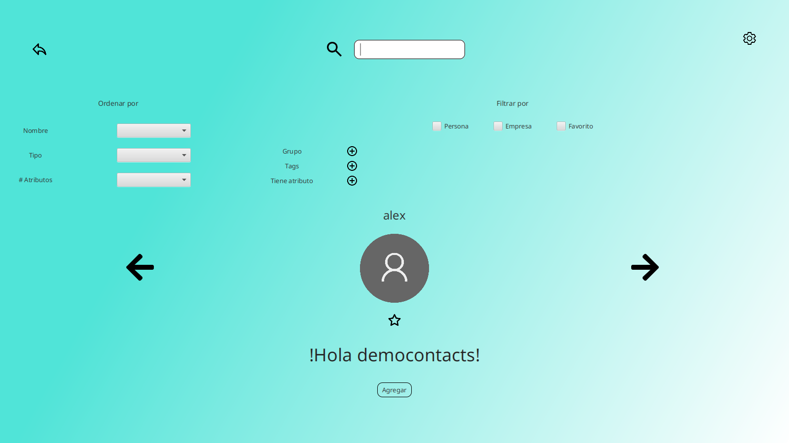
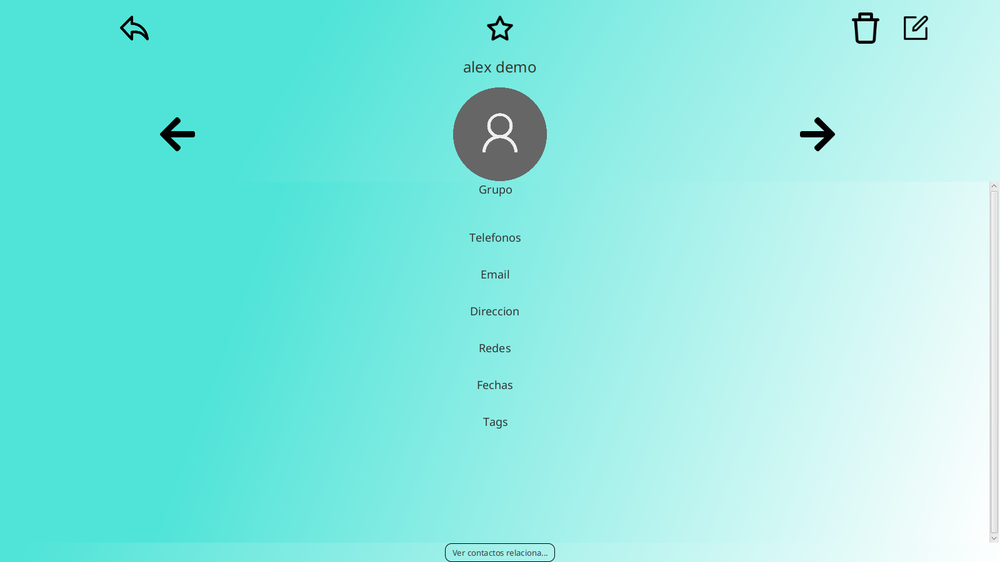

# Modern Contacts

Modern Contacts is a JavaFX desktop address book for people and companies. It supports search, sorting, favorites, groups, tags, and related contacts.



## Run locally

Use a JDK, Maven, and a graphical desktop session. The project targets Java 11, and the command below was verified on Linux with JDK 21. Maven downloads JavaFX and the other dependencies on the first run.

From the repository root, where `pom.xml` is located, run:

```sh
mvn clean javafx:run
```

The app resolves its data and image paths from the working directory, so run it from the project root. If your shell cannot find Maven, run `mvn -v` after adding Maven to your PATH. With an existing SDKMAN Maven installation, you can also use `~/.sdkman/candidates/maven/current/bin/mvn clean javafx:run`.

## Use the address book

1. Click **Registrarse** (Register), enter a username and a password of at least eight characters, and submit the form. Sign in with that username in the **Correo** field.
2. Click **Agregar** (Add), then choose **Persona** (Person) or **Empresa** (Company). Enter the contact's details and click **Guardar** (Save).
3. Use the arrows to browse contacts. Click a contact's image to view its details. Use the star to mark a favorite and the pencil icon to edit the record.
4. Use the search field, sort controls, and filters to narrow the address book.



## How the linked list stores contacts

Each [`User`](src/main/java/dsa/contacts/model/User.java) owns a `DoublyCircular<Contact>`. Each [`Contact`](src/main/java/dsa/contacts/model/Contact.java) also has a list of the same type for related contacts. The list is a project implementation in [`DoublyCircular.java`](src/main/java/dsa/contacts/ds/DoublyCircular.java).

- **Nodes and links.** Each node holds a contact and two references, `next` and `prev`. The list tracks `head`, `tail`, and the element count `n`. The forward link from the tail goes back to the head, so traversal uses the count to stop after visiting each contact once.
- **Adding and removing contacts.** Saving a new contact appends a node through `getContacts().add(...)`. The list uses its tail reference to append in constant time. Deletion calls `remove(...)`, which can scan for a match and rewires the neighboring links when it finds one.
- **Displaying contacts.** [`HomeController.restoreContacts()`](src/main/java/dsa/contacts/controllers/HomeController.java) copies contacts from the linked list into the project's custom array list. The home screen sorts and filters that copy and wraps its selected index when you click an arrow.

The list includes a reverse iterator that follows `prev` from the tail. Appending a node does not refresh `head.prev`, so that backward link can become stale. The home screen's arrows use the array list index described above.

## How it’s built

JavaFX controllers handle the FXML screens and call the Java model for contact operations. [`App`](src/main/java/dsa/contacts/App.java) loads and saves the user collection, including each user's contacts, with Java serialization in `src/main/resources/dsa/contacts/serializables/users.ser`. The project also uses ez-vcard for vCard handling.

## License

[MIT](LICENSE)
